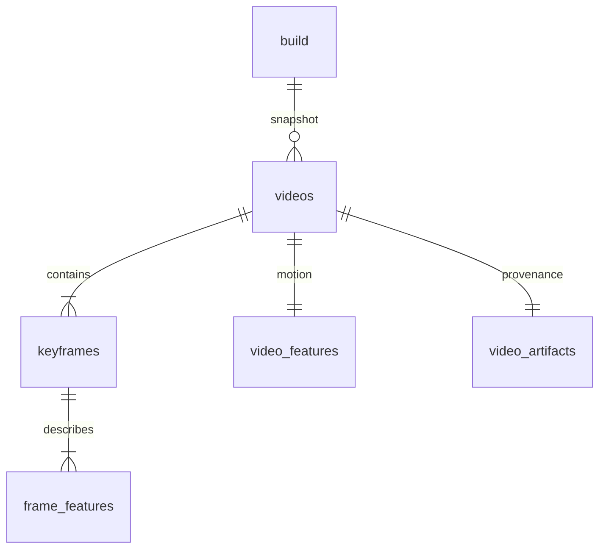

# CSDL và quy trình build giai đoạn 3

**Cập nhật MySQL:** backend vận hành hiện tại là MySQL `d23_nhom12`, xem [hướng dẫn quản lý](MYSQL.md) và [kết quả đối chiếu dữ liệu](search_phases/03_MYSQL.md). Các mục SQLite dưới đây mô tả checkpoint trích/phục hồi và bản đối chiếu được giữ nguyên. Truy vấn mặc định dùng `var/current_mysql_index.json` và đọc vector từ MySQL.

## Dữ liệu lưu trữ



| Bảng | Vai trò |
| --- | --- |
| `build` | Trạng thái kỹ thuật, snapshot nguồn, spec/model/implementation identity, root dữ liệu và trạng thái quality review |
| `videos` | ID/lớp/đường dẫn tương đối, SHA256, size, metadata, crop và quality JSON |
| `keyframes` | Khóa video_id+frame_index; target_time và actual_time; ảnh khung khớp |
| `frame_features` | HSV128,LBP10,CLIP512 float32 từng khung; khóa ngoại đến đúng khung và ràng buộc kích thước BLOB |
| `video_features` | Một vector Flow24/video, ba khối L1 |
| `feature_catalog` | Dimension, normalization và distance |
| `video_artifacts` | Manifest SHA256 của16PNG và NPZ; dùng kiểm tra trước reuse và nghiệm thu |

Mỗi generation có `context.json`, `snapshot.json`, `manifest.json`, `environment.json`, `events.jsonl`, `progress.json` và DB. Mỗi video được ghi bằng transaction riêng sau khi đã trích đủ các descriptor; thiếu một descriptor không được bù bằng vector0.

`crop_json` là tọa độ `(x0,y0,x1,y1)` trên khung đã decode về cạnh ngắn360, không phải tọa độ pixel của MP4 gốc. `target_time`/`actual_time` và các PTS trong NPZ đều tính bằng giây. Metadata tách kích thước coded và kích thước hiển thị sau rotation. Mỗi file DB chỉ có một build record; liên hệ build→videos trong sơ đồ là quan hệ snapshot của generation.

## Trạng thái

- `build.status=building`: còn đang xử lý hoặc tạm dừng có kiểm soát.
- `build.status=failed`: session gặp lỗi; xem `failure.json` và events; có thể resume nếu context vẫn khớp.
- `build.status=ready`: đủ danh sách video và descriptor, timestamp/vector/artifact/nguồn đã qua kiểm tra. DB được đóng rồi đổi tên thành `index.sqlite`.
- `quality_status=pending/reviewed/issues`: trạng thái review nội dung, độc lập với trạng thái kỹ thuật. Pending không tự được đổi thành reviewed sau khi build xong.

`quality_json` từng video giữ các trường scene/trùng/logo. Review chỉ áp dụng khi SHA của review khớp SHA hiện tại; review cũ trở thành stale, không được coi đã xác nhận. Review còn pending không làm mất quyền build thử hệ thống; cũng không được dùng làm chứng nhận dữ liệu đạt mọi điều kiện học thuật.

## Cách chạy

```powershell
cd 'D:/video csdldpt/he_thong_nhom12'
./scripts/Run.ps1 build
./scripts/Run.ps1 build --resume 'var/build-ID'
./scripts/Run.ps1 verify --index 'var/build-ID/index.sqlite'
```

`--reviews PATH` tùy chọn nhận JSON review theo ID và SHA. Không điền true nếu chưa có bằng chứng. `--stop-after N` là phép dừng có kiểm soát để kiểm chứng phục hồi; DB còn thiếu dữ liệu vẫn là building.

Sau khi nghiệm thu thành công, `var/current_index.json` trỏ đến index hiện hành đã xác minh. Dùng pointer này khi bắt đầu giai đoạn4 thay vì đoán đường dẫn generation mới nhất từ thời gian thư mục.

## Điều kiện resume

Phải trùng source snapshot, spec hash, model identity, device, phiên bản dependency, implementation version và code hash. Context khác bị từ chối trước khi sử dụng vector cũ. Không tự nhập generation của dự án cũ.

Với video đã ghi: kiểm tra metadata/hash, đủ16 khung, đủ48 vector khung, Flow và checksum ảnh/NPZ. Nếu mất/hỏng artifact hoặc vector sai, chỉ bản ghi đó được trích lại trong attempt folder mới. Những attempt cũ không còn được DB tham chiếu được giữ lại, không tự xóa thư mục tính toán. Với video chưa hoàn thành: thực hiện từ đầu, không dùng một phần vector dang dở.

Khi thay đổi mã về sau, cần giữ khả năng đối chiếu phiên bản trích. Generation của full build có bản lưu source và checksum trong `implementation_sources/` và `implementation_sources.json`. Không ghi lại hash trong index chỉ để bỏ qua lỗi tương thích.

## Kiểm tra cuối

Đối chiếu N/16N/48N/N cho video/keyframe/frame feature/motion. Kiểm tra FK, SQLite integrity, vector finite/norm/dtype, thứ tự timestamp, toàn bộ artifact checksums và nguồn chưa thay đổi. Chỉ sau đó đánh dấu ready. Kiểm chứng bổ sung bằng cách trích trực tiếp một số video và so BLOB DB với output thật.

Full build kỹ thuật không thay cho đánh giá chất lượng truy vấn, review một scene hoặc phán đoán trùng cảnh. Những nội dung đó được giữ ở luồng riêng và không bị báo cáo là đã hoàn thành chỉ từ số lượng vector.
