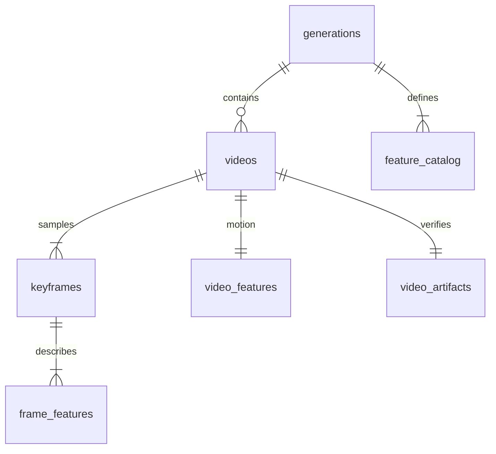

# Quản lý hệ thống bằng MySQL

Hệ thống dùng database `d23_nhom12` trên MySQL tại `127.0.0.1:3306`. Kết nối ứng dụng chỉ đọc nằm trong `.mysql.local.json`; kết nối quản trị riêng ở `.mysql.admin.local.json`, cả hai bỏ qua bởi Git. `mysql.local.example.json` là mẫu trống. Không đưa file có mật khẩu vào báo cáo, ZIP hoặc kho mã. Cập nhật 25/11: xem [hướng dẫn vận hành](HOAN_THIEN_VAN_HANH.md) để dùng review, metadata và incremental.

## Cấu trúc và mapping báo cáo



Mọi khóa đều có `generation_id` để dữ liệu của các lần xây dựng không trộn lẫn. Các bảng dùng InnoDB, khóa ngoại và ràng buộc kích thước vector. `generations.context_json` giữ snapshot nguồn, spec, model, môi trường trích và trạng thái kiểm duyệt.

| Báo cáo/yêu cầu | Dữ liệu MySQL |
| --- | --- |
| ND1: bộ video, lớp cảnh, đặc điểm tương đồng/khác biệt | `videos`: ID, lớp, đường dẫn, SHA256, metadata, crop, quality |
| ND2: HSV128, LBP10, CLIP512 | `feature_catalog`, `frame_features`: đủ ba vector cho từng khung |
| ND2: Optical Flow24 | `video_features`: một vector motion/video, chuẩn hóa L1 riêng ba khối |
| ND3: đủ đặc trưng mọi video | `keyframes` có 16 khung/video; ràng buộc FK và bộ kiểm tra Python xác minh số lượng, timestamp, finite/norm |
| ND4: một ảnh → năm video riêng biệt | Truy vấn đọc vector từ MySQL, tính khoảng cách và điểm ở Python, hợp nhất trên cùng khung rồi lấy khung tốt nhất/video |

Vector lưu dạng BLOB float32 little-endian, giữ nguyên byte của kết quả trích. HSV/LBP/CLIP lần lượt 512/40/2048 byte; motion 96 byte. Ảnh truy vấn không có vector chuyển động. Trọng số ảnh 0,95/0,05/0 đã chọn bằng validation, đánh giá độc lập đang để riêng. Video dùng cấu hình riêng 0,90/0,05/0/0,05 cho CLIP/HSV/LBP/Flow; B0–B8 đã hoàn thành.

MP4, PNG keyframe, NPZ và checkpoint nằm trên hệ thống file; MySQL quản lý đường dẫn và checksum. Không chuyển MP4 thành BLOB. Đường dẫn artifact đang gắn với máy hiện tại.

## Các lệnh sử dụng

Chạy trong `D:/video csdldpt/he_thong_nhom12`:

```powershell
./scripts/Run.ps1 mysql doctor
./scripts/Run.ps1 mysql list
./scripts/Run.ps1 mysql verify
./scripts/Run.ps1 query --image 'D:/duong-dan/anh.jpg'
./scripts/Run.ps1 query-batch --images 'D:/duong-dan/a.jpg' 'D:/duong-dan/b.png'
```

`config.json` chọn `database.backend=mysql`. Truy vấn mặc định lấy generation trong `var/current_mysql_index.json`. Có thể truyền `query --index GENERATION_ID --image ...` để chọn một generation sẵn sàng. Kết quả gồm HTML và trace JSON; trace ghi `mysql:database/generation` cùng điểm và khung khớp. Lỗi MySQL được báo rõ và không tự chuyển sang một index khác.

Giai đoạn4 bổ sung `SearchSession`, ma trận đặc trưng trong RAM và `retrieval_revisions` với21trigger theo dõi7bảng. Hiện tại bước cài đặt đã tách cho admin (`run.py --config var/admin.config.json mysql setup`); ứng dụng chỉ cần SELECT và EXECUTE `nh12_retrieval_stamp`, không tạo bảng/trigger khi tìm kiếm. Dữ liệu gốc trong các bảng đã chứng nhận được giữ nguyên. Revision tăng trong cùng transaction; phiên kiểm tra revision/context/count/trigger trước và sau lượt tìm, nên cập nhật index sẽ yêu cầu mở phiên mới. Truy vấn nhiều ảnh dùng chung phiên tránh nạp lại model/index; xem [hướng dẫn tìm kiếm](HUONG_DAN_TIM_KIEM.md).

Để nhập lại bản trích đã có hoặc đối chiếu đầy đủ:

```powershell
$source = (Get-Content -LiteralPath var/current_index.json -Raw | ConvertFrom-Json).index
.\.venv\Scripts\python.exe run.py --config var/admin.config.json mysql migrate --source $source
.\.venv\Scripts\python.exe run.py mysql verify --source $source
```

Migration kiểm tra nguồn, artifact, spec/model/môi trường và tính tương thích mã trích; đối chiếu toàn bộ cột, JSON theo giá trị và BLOB theo từng byte. Cùng một SHA256 SQLite dùng cùng generation ID; chạy lại sẽ kiểm tra bản đang có. Dữ liệu chỉ được commit và chuyển `ready` sau khi đối chiếu thành công. Khi lỗi, các hàng nhập trong transaction được rollback và marker chuyển `failed`, có thể chạy lại.

SQLite gốc được giữ nguyên để dự phòng/đối chiếu. Với build mới, bước trích vẫn ghi checkpoint SQLite để phục hồi từng video; build đầy đủ sẽ xuất bản vào MySQL. Build dở dang không xuất bản. Khi chỉ thay phần lưu trữ/giao diện, hệ thống dùng source archive đã chứng nhận để xác minh các module/hàm trích vẫn giữ nguyên; không ghi lại hash cũ để vượt kiểm tra.

## Xem trong MySQL Workbench

1. Kết nối MySQL đang dùng tại `127.0.0.1:3306` bằng tài khoản trong file cấu hình.
2. Refresh **SCHEMAS**, mở `d23_nhom12` → **Tables** và **Views**.
3. Mở [mysql_management.sql](../sql/mysql_management.sql) để xem số lượng, lớp, keyframe, kích thước vector và trạng thái review lúc build; các câu DDL trong file chỉ chạy bằng admin.
4. View `v_video_metadata` đã cài: duration/fps/kích thước/codec và `indexed_review_status`; [metadata_examples.sql](../sql/metadata_examples.sql) có câu lọc mẫu. `v_video_overview` là view bổ sung trong script quản trị. Query có điều kiện generation giúp tránh đếm lẫn các lần build. Review cập nhật sau build nằm ở sổ SHA256 riêng, không trộn với trạng thái lúc trích.

Các thế hệ `ready` là bản kết quả trích đã kiểm chứng. Thay đổi thuật toán/nguồn/đặc trưng phải tạo build mới để giữ dấu vết đối chiếu. Review scene, trùng cảnh và logo vẫn pending cho đến khi nhóm xem và gắn nhãn thực tế.

## Kiểm thử

`tests/test_mysql.py` dùng MySQL thật với adapter media giả lập rõ ràng: đối chiếu dữ liệu, nhập lặp, rollback/retry, ràng buộc BLOB/FK và truy vấn không mở SQLite. Chỉ chạy khi có biến `NHOM12_MYSQL_TEST_CONFIG` trỏ đến file kết nối database kiểm thử riêng; không dùng database chính cho fixture.

Các bằng chứng chuyển dữ liệu thật nằm trong `var/search_phases/03_mysql/`. Xem [kết quả chuyển MySQL](search_phases/03_MYSQL.md) để biết số lượng và kiểm chứng thực tế.

Tài liệu API: [MySQL Connector/Python – kết nối](https://dev.mysql.com/doc/connector-python/en/connector-python-example-connecting.html), [tham số kết nối và transaction](https://dev.mysql.com/doc/connector-python/en/connector-python-connectargs.html).
