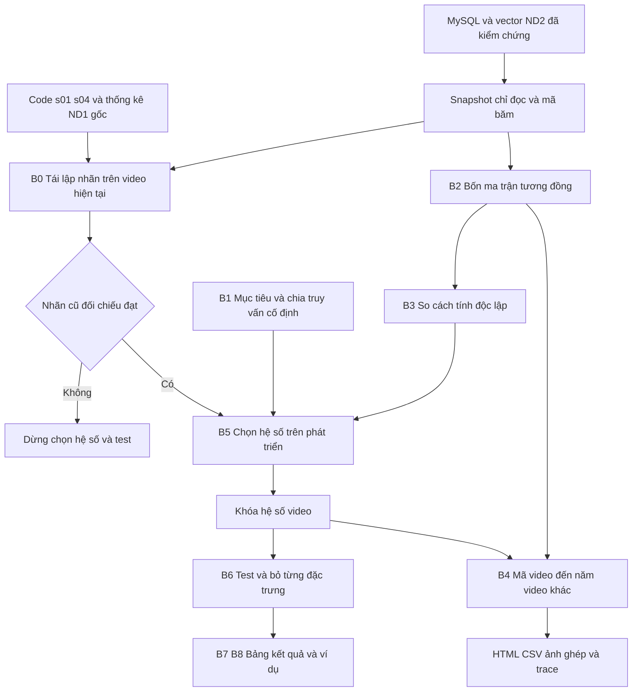

# Cơ chế tìm video tương đồng và đối chiếu ND1 ND2

ND3 trích và quản trị toàn bộ đặc trưng của video, đồng thời trình bày cơ chế tìm các video tương đồng dựa trên siêu dữ liệu đó. Chế độ này nhận mã một video đã có trong MySQL và trả năm video khác. ND4 nhận một ảnh tùy chọn và có chính sách riêng.

Lệnh, điều kiện đạt và tệp trung gian của từng bước nằm trong [hướng dẫn tự chạy B0–B8](../scripts/video_similarity/README.md). Một lần thực hiện được giữ trong `var/video_similarity/run01/`; làm lại từ đầu dùng thư mục run khác.

## Đóng góp và cách đo từng đặc trưng

| Khía cạnh ND1 | Biểu diễn ND2 | Đóng góp trong tìm kiếm ND3 | Đánh giá trên top 5 |
|---|---|---|---|
| D1 màu sắc, Bảng 1.5 trang 13 | HSV128 mỗi khung, mục 2.3 | Phân biệt diện mạo màu sắc, tông màu và điều kiện sáng | Cùng `dominant_group` theo đúng s04 ND1 |
| D2 kết cấu, Bảng 1.5 | LBP10 mỗi khung, mục 2.4 | Bổ sung mẫu biến đổi cục bộ của bề mặt | Cùng mức mật độ Canny ND1; đây là chỉ báo liên quan đến kết cấu, không đồng nhất với LBP |
| D4 chủ thể và một phần D3 bố cục | CLIP512 mỗi khung, mục 2.5 | Phân biệt ngữ nghĩa loại cảnh/chủ thể | Cùng lớp cảnh; chưa có phép đo riêng D3 bố cục |
| D5 biến đổi theo thời gian | Flow24 mỗi video, mục 2.6/Bảng 2.7 | Bổ sung kiểu chuyển động toàn phần, cục bộ và hướng | Cùng mức hiệu mức xám ND1; không phải chính vector Flow |

Code khảo sát gốc giữ cả tám tỷ lệ màu và nhãn `dominant_color`, rồi ánh xạ màu thắng sang năm giá trị `dominant_group`. Vì vậy giữ tám màu ở dữ liệu chi tiết và dùng năm nhóm có sẵn để tái lập phép đánh giá ND1. Không cộng các tỷ lệ thành năm nhóm trước khi lấy argmax.

Các độ đo tự động có liên hệ tự nhiên với đặc trưng tương ứng. Kết quả chứng minh mức phù hợp với định nghĩa tương đồng đã khai báo, chưa thay thế hoàn toàn nhãn liên quan của người dùng.

## Module và dữ liệu vào ra

`video_search.py` chỉ tính điểm; không đọc nhãn ND1 hoặc tự loại lớp. `video_workflow/data.py` đọc vector từ MySQL và kiểm tra generation/revision, nguồn video, chuẩn đặc trưng và artifact. `nd1_original.py` tái lập cách đo s01/s04, lưu khung và đối chiếu metadata cũ. `metrics.py` tính các độ đo, macro và SE. `stages.py` điều phối B1–B8; `presentation.py` xuất bằng chứng và tính lại trace. CLI nằm trong `video_workflow/cli.py`.

## So sánh hai tập khung

Với mỗi đặc trưng f thuộc CLIP, HSV, LBP, gọi s_f(i,j) là điểm của khung i trong video A với khung j trong video B:

`S_f(A,B) = 0.5 × [mean_i max_j s_f(i,j) + mean_j max_i s_f(i,j)]`.

CLIP dùng `(1+cosine)/2`; HSV dùng `1-d_Bhattacharyya`; LBP dùng `1-d_Chi-square`. Ba ma trận được tính riêng. Mỗi đặc trưng có thể ghép một cặp khung khác nhau. Trang kết quả giữ các bằng chứng riêng, không gán một khung đại diện tùy ý cho điểm tổng.

Đối với chuyển động, `S_motion = 1 - d_Chi-square/3`. Mỗi khối của Flow24 đã L1 riêng nên khoảng cách tổng của ba khối có thể tới 3. Quy đổi khoảng cách không thay vector gốc trong MySQL.

Điểm cuối `S_video = w_clip S_clip + w_hsv S_hsv + w_lbp S_lbp + w_motion S_motion`, các hệ số không âm và tổng 1. Xếp hạng loại video truy vấn; hòa điểm theo ID. Phép so tập khung không bảo toàn thứ tự thời gian. Điểm không phải xác suất phù hợp.

## Tái lập ND1 và danh tính video cũ

Chương trình đọc trực tiếp các ngưỡng đã lưu trong `ch1_stats.json`. D2 dùng Canny(100,200), D5 dùng hiệu mức xám float32 trên tám cặp ảnh xám cạnh ngắn 180. Các chi tiết giải mã, resize và ánh xạ nhãn được đối chiếu với s01/s04 gốc, tách khỏi quá trình trích ND2 đang lưu trong MySQL.

Nguồn ND1 cũ không có SHA256 lịch sử của video. Nhóm có cùng kích thước với manifest cũ dự kiến có 511 video; chương trình báo cáo riêng việc khớp nhãn và so 32 khung. Không dùng “cùng kích thước” làm bằng chứng đủ để khẳng định hai file giống từng byte. Các nguồn gốc, mã băm file thống kê/code và SHA256 video hiện tại được giữ trong run.

## Chọn hệ số và đánh giá

Truy vấn được chia theo lớp với seed cố định, theo nhóm nếu có danh sách cùng cảnh/cùng nguồn. Kho tìm kiếm vẫn đủ toàn bộ video và loại chính truy vấn. Phạm vi kết luận là truy vấn giữ riêng trên một kho cố định; không phải kiểm tra trên kho video mới.

Mỗi truy vấn có bốn giá trị: tỷ lệ cùng lớp, cùng D1, cùng D2 và cùng D5 trong top 5. Tính trung bình trong lớp rồi macro qua sáu lớp. Điểm mục tiêu là trung bình bốn giá trị của từng truy vấn; tính SE sau phép tổng hợp để giữ hiệp phương sai giữa các độ đo. Khi có nhóm nhiều truy vấn, SE dùng tổng sai lệch theo nhóm trong từng lớp.

Lưới đã khai báo có 125 tổ hợp: HSV/LBP/Flow mỗi hệ số từ 0 tới 0,20 bước 0,05; CLIP nhận phần còn lại và không nhỏ hơn 0,4. Trước hết giới hạn mức giảm P@5 lớp bằng 1-SE của cấu hình có P@5 tốt nhất trên phát triển. Sau đó áp dụng vùng 1-SE của mục tiêu tổng hợp; ưu tiên ít đặc trưng hoạt động và CLIP cao. Quy tắc này không bảo đảm mỗi bộ nhận trọng số dương, không phải kiểm định ý nghĩa thống kê và không được thay sau khi xem test.

Trên test, giữ hệ số đã khóa, báo cáo bốn bộ dùng riêng, cấu hình chọn và bốn cấu hình bỏ lần lượt một bộ. Phần còn lại được chuẩn hóa tổng 1, không tìm lại hệ số. Có chênh lệch ghép cặp và chỉ số đồng thời cùng lớp/cùng thuộc tính. Mức ngẫu nhiên dùng chính số lượng nhãn trong kho sau khi loại video truy vấn, không mặc định bằng 1/3.

## Bằng chứng kiểm thử

Các kiểm thử số học gồm miền điểm, đối xứng, phép so tự thân được hòa, đối chiếu cách tính scalar độc lập, hoán vị khung, Flow ba khối, loại truy vấn, hòa điểm, phát hiện artifact đổi và chặn dùng nhãn chẩn đoán để chọn hệ số. Fixture đầu cuối dùng dữ liệu tổng hợp được ghi rõ để kiểm tra khóa mục tiêu, lựa chọn và test giữ riêng; không coi fixture là chất lượng tìm kiếm thật.

Các kết quả thật nằm trong `b0/baseline_check.json`, `b3/result.json`, `b5/bang_luoi.csv`, `trong_so_video.json` và `b6/result.json`. Thời gian dựng snapshot/ma trận, tra ma trận đã nạp và xuất kết quả được ghi riêng. Giữ cả số kiểm thử bị bỏ qua; không tính skipped thành passed.

## Kết quả lần chạy run01

B0 tính lại đủ 561 video bằng ngưỡng cũ. Cả 511 video thuộc nhóm khớp kích thước manifest đều khớp ba nhãn; phép tính lại từ cache cũ khớp metadata cũ. Có 13 trường hợp khung lấy lại khác pixel nhưng nhãn không đổi, được liệt kê trong [đối chiếu B0](../var/video_similarity/run01/b0/baseline_check.json). Nguồn cũ không có SHA256 lịch sử nên không kết luận danh tính từng byte từ kích thước file.

50 video đã thay được dùng nhãn đo mới, không chép lại nhãn mô tả nội dung cũ. Ví dụ SEA001: metadata cũ ghi mật độ cạnh 0,1705 và chuyển động 8,52; video hiện tại cho khoảng 0,107343 và 12,752737, tương ứng D2 trung bình và D5 mạnh. Có thể tự tính lại bằng `giai_thich_nhan.py`; xem [bản giải thích SEA001](../var/video_similarity/run01/explanations/SEA001.txt).

279 truy vấn phát triển chọn trên 125 tổ hợp; 282 truy vấn được giữ riêng cho kiểm tra. Hệ số video khóa là CLIP 0,90 / HSV 0,05 / LBP 0 / Flow 0,05. Không đổi hệ số ảnh ND4. [File khóa](../var/video_similarity/run01/trong_so_video.json) giữ cả mục tiêu và mã băm đầu vào.

| Cấu hình trên tập kiểm tra | Cùng lớp | D1 | D2 | D5 | Tổng hợp |
|---|---:|---:|---:|---:|---:|
| CLIP riêng | 0,9529 | 0,4335 | 0,5805 | 0,4537 | 0,6051 |
| HSV riêng | 0,4733 | 0,6536 | 0,4917 | 0,3702 | 0,4972 |
| LBP riêng | 0,4834 | 0,3478 | 0,6159 | 0,4324 | 0,4699 |
| Flow riêng | 0,3229 | 0,2503 | 0,4686 | 0,6878 | 0,4324 |
| Cấu hình khóa | 0,9473 | 0,4989 | 0,5656 | 0,5530 | 0,6412 |
| Bỏ Flow khỏi cấu hình khóa | 0,9447 | 0,5237 | 0,5755 | 0,4647 | 0,6272 |
| Kỳ vọng ngẫu nhiên | 0,1652 | 0,2189 | 0,3337 | 0,3323 | 0,2625 |

Nguồn: [bảng đầy đủ và SE](../var/video_similarity/run01/b6/bang_dong_gop.csv), [chi tiết theo truy vấn và lớp](../var/video_similarity/run01/b6/result.json).

CLIP dùng riêng tốt nhất về cùng lớp trong các cấu hình đơn. HSV đơn đạt cao nhất về D1, LBP đơn về D2, Flow đơn về D5; đây là bằng chứng phù hợp với vai trò ND2 gán cho từng bộ trên các nhãn tự động ND1. Cấu hình khóa tăng mục tiêu tổng hợp so với CLIP riêng nhưng giảm P@5 lớp khoảng 0,56 điểm phần trăm. Bỏ Flow làm D5 giảm khoảng 8,83 điểm phần trăm; sự thay đổi ở các khía cạnh khác cho thấy có đánh đổi, không phải mọi độ đo cùng tăng.

LBP vẫn có vai trò mô tả và được đánh giá độc lập, nhưng không nhận trọng số trong cấu hình được chọn theo mục tiêu, lưới và quy tắc đơn giản hóa đã khai báo. Không suy rộng kết quả này thành LBP luôn không hữu ích. Các phép bỏ đặc trưng giữ tỷ lệ hệ số còn lại, không chọn lại theo test.

49 kiểm thử đã qua, gồm 37 ca cũ và 12 ca ND3, không bỏ qua; có ba ca MySQL thật trên instance kiểm thử riêng. B3 đối chiếu 24 cặp độc lập, sai lệch lớn nhất khoảng 3,33e-16. [Log kiểm thử](../var/video_similarity/regression_final.log) và [kiểm tra bảo toàn](../var/video_similarity/run01/verification/preservation.json) được giữ lại. Trình truy cập browser không khả dụng trong phiên kiểm tra; ảnh ghép và trace đã kiểm tra, chưa xác nhận phát media trực tiếp trong browser.

Ba ví dụ B8 là FOR066 (ca tốt), FOR030 (P@5 lớp thấp nhất) và WAT028 (mức tăng D5 lớn nhất khi có Flow). Với WAT028, cả hai cấu hình đều trả năm video thác nước, nhưng D5 tăng từ 1/5 lên 4/5 khi có Flow. [Bảng đổi thứ hạng](../var/video_similarity/run01/b8/flow_change.csv) ghi rõ từng video được thay; không diễn giải chúng thành “thác đứng yên” nếu chưa quan sát chuyển động thực.

Mở [trang tổng hợp và các ví dụ](../var/video_similarity/run01/index.html). Cả ba trace đã được tính lại từ vector và ma trận, kiểm tra đủ năm video khác truy vấn, điểm giảm dần, tổng đóng góp đúng điểm tổng và nhãn ND1 đã được xác nhận. [Kết quả kiểm tra ví dụ](../var/video_similarity/run01/verification/final_examples.json) phân biệt phép kiểm tra này với kiểm thử phát media trong browser.
