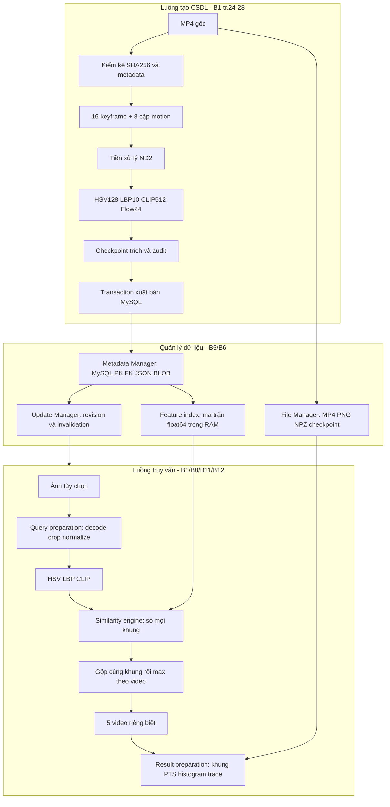
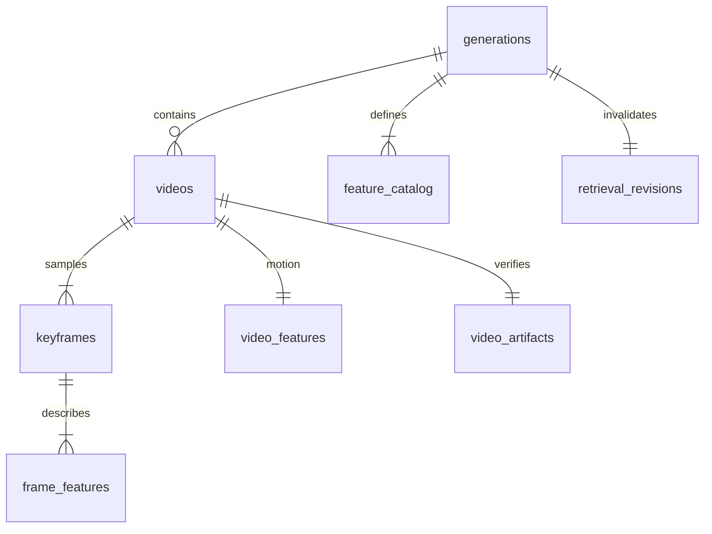

# Thiết kế hệ thống D23 nhóm12 theo toàn bộ slide môn học

**Bổ sung bộ MMDB:** [Đối chiếu hai bộ bài giảng và phương pháp tìm kiếm](DOI_CHIEU_HAI_BO_SLIDE_VA_PHUONG_PHAP_TIM_KIEM.md) phân tích thêm12 PDF/585trang trong `MMDB slides`, đặc biệt Rocchio, độ đo histogram và đánh giá. Số bài trong hai bộ khác nhau; không dùng số bài tiếng Việt để dẫn trực tiếp bộ MMDB. Tài liệu đối chiếu phân biệt rõ trọng số phản hồi/màu/từ khóa với trọng số kết hợp CLIP/HSV/LBP.

Tài liệu tổ chức thiết kế từ kiến thức trong **12 bài, 386 trang PDF** của `HeCSDL_DPT_slides`, nối với báo cáo nội dung1–2, yêu cầu Excel và module đang chạy. Phần đọc slide đã bao phủ mọi trang; các sơ đồ kiến trúc, metadata và công thức quan trọng được render để kiểm tra trực quan. Bản trích từng trang và SHA256 nguồn nằm trong `var/course_slides/`; [course_mapping.json](course_mapping.json) là bảng đối chiếu có thể kiểm tra bằng script.

**Quy ước dẫn nguồn:** mọi số trang dưới đây là thứ tự **trang trong PDF, bắt đầu từ1**. Một số slide có số in trên trang khác số trang PDF, đặc biệt Bài4 và Bài6. Dẫn `B4 tr.8` nghĩa là trang PDF8, hình nguyên lý kết hợp có số in12.

Đề Excel của nhóm D23, sheet `Trang tính1`, D34:G36 và E2:G2, quyết định sản phẩm bắt buộc. Báo cáo phần1–2 quyết định bộ đặc trưng và tham số nhóm đã chọn. Slide cung cấp cơ sở thiết kế và những phương án để cân nhắc; không biến mọi thuật toán ví dụ trong slide thành chức năng bắt buộc. Riêng tỷ lệ đánh giá khái quát ở B1 tr.4 không thay thế lịch/tỷ lệ từng báo cáo trong Excel.

## 1. Bản đồ đầy đủ 12 bài

| Bài và nguồn | Trang PDF | Kiến thức và quyết định thiết kế | Áp dụng / giới hạn |
| --- | ---: | --- | --- |
| [B1 Giới thiệu](../../HeCSDL_DPT_slides/Bai%201%20-%20Gioi%20thieu.pdf) | 1–51 | Đối tượng gốc + metadata + đặc trưng (14–20); ngoại tuyến/trực tuyến, query/result preparation (24–28); semantic gap (29); efficiency/effectiveness, precision/recall (43–51) | `building`, MySQL, `SearchSession`, trace, `evaluation`; chưa có nhãn relevance để công bố hiệu quả học thuật |
| [B2 Các loại dữ liệu](../../HeCSDL_DPT_slides/2%20-%20Cac%20loai%20du%20lieu%20DPT.pdf) | 1–37 | Ảnh ma trận và không gian màu (3–16); tín hiệu âm thanh (17–27); văn bản (28–30); cấu trúc không gian–thời gian video và metadata (31–37) | RGB/HSV, ảnh keyframe, actual PTS, MP4; âm thanh/văn bản là nhánh mở rộng |
| [B3 Nén](../../HeCSDL_DPT_slides/3-%20Nen%20du%20lieu%20DPT.pdf) | 1–36 | Lấy mẫu/lượng tử âm thanh (3–18); dung lượng, nén ảnh, DCT/JPEG (19–28); dư thừa không gian–thời gian, bù chuyển động (29–31); Huffman/RLE/LZW (32–36) | Giữ MP4/H.264 nguồn, PNG/NPZ dẫn xuất; decode trước trích; không tự cài codec hay dùng vector codec thay Flow |
| [B4 Kiến trúc](../../HeCSDL_DPT_slides/4%20-%20Kien%20truc%20he%20CSDL%20DPT.pdf) | 1–28 | Tập trung/phân tán, riêng biệt/đồng nhất/kết hợp (2–8); server/khách–chủ (9–17); P2P/phân tán (18–20); quản lý nội dung, streaming/bộ đệm (21–28) | Kiến trúc tập trung phân tầng, Python khách của MySQL; HTML kết quả; HTTP/media server thuộc giai đoạn5, chưa triển khai P2P/phân tán |
| [B5 Mô hình hóa](../../HeCSDL_DPT_slides/5%20-%20Mo%20hinh%20hoa%20du%20lieu%20DPT.pdf) | 1–23 | Quan hệ và giới hạn (2–4); đối tượng/lớp/miền/thuộc tính (5–17); phương thức, kiểu I/O, kế thừa, ODL/OQL (18–23) | Quan hệ MySQL với PK/FK; JSON cho metadata biến đổi; lớp dịch vụ có I/O rõ ràng; không gọi MySQL là OODB/ODL |
| [B6 Siêu dữ liệu](../../HeCSDL_DPT_slides/6%20-%20Sieu%20du%20lieu%20va%20CSDL%20DPT.pdf) | 1–34 | Perceptual/semantic gap (2–8); taxonomy và nội dung ảnh/video (9–24); ba mức diễn tả (25–29); Query/Update/Security/Index Manager và kiến trúc mở (30–34) | Metadata kỹ thuật, đặc trưng, quality/provenance; tách file gốc khỏi metadata manager; review ngữ nghĩa vẫn pending |
| [B7 Dữ liệu nhiều chiều](../../HeCSDL_DPT_slides/7%20-%20Cau%20truc%20du%20lieu%20da%20chieu.pdf) | 1–62 | Truy vấn exact/partial/range (4); k-d/NN/k-NN (7–21); quadtree/MX/PR (22–48); R-tree/MBR (49–62) | Phân biệt chỉ mục SQL và không gian vector; quét toàn bộ ma trận làm baseline; chưa cài k-d/quadtree/R-tree cho CLIP |
| [B8 Vector và phân cụm](../../HeCSDL_DPT_slides/8%20-%20Truy%20van%20khong%20gian%20vecto%20va%20phan%20cum.pdf) | 1–27 | Biểu diễn vector, tích vô hướng/cosine và xếp hạng (2–9); phản hồi (10–13); độ đo và phân cụm/pairwise/k-means (14–27) | Cosine CLIP, chuẩn hóa thang điểm và xếp hạng; chưa phân cụm/prune theo lớp, chưa có relevance feedback |
| [B9 Văn bản/Boolean](../../HeCSDL_DPT_slides/9%20-%20Du%20lieu%20van%20ban%20va%20Boolean.pdf) | 1–18 | Stop words, stemming/synonyms (2–3); DBMS khác IR (4–5); flat/signature/inverted file và Boolean (6–13); TF–IDF, Boolean trọng số (14–18) | SQL quản trị metadata là so khớp có cấu trúc; ảnh→video là IR tương đồng; chưa OCR/ASR/keyword/inverted file, không thay tìm ảnh bằng lọc tên/lớp |
| [B10 Âm thanh](../../HeCSDL_DPT_slides/10%20-%20Chi%20so%20hoa%20va%20truy%20van%20du%20lieu%20am%20thanh.pdf) | 1–29 | Năng lượng/ZCR/khoảng lặng (5–9); Fourier/phổ/pitch (10–16); phân loại/vector/segment (17–22); ASR/âm nhạc (23–29) | Giữ âm thanh có sẵn khi phát MP4; bộ tìm kiếm hiện dùng thị giác, chưa có descriptor âm thanh hoặc ASR |
| [B11 Ảnh](../../HeCSDL_DPT_slides/11%20-%20Chi%20so%20hoa%20va%20truy%20van%20du%20lieu%20anh.pdf) | 1–27 | Metadata/text/CBIR (3–8); histogram, độ đo và giới hạn màu (9–18); shape/moment (19–25); texture/bố cục (26); miền nén (27) | HSV histogram, LBP kết cấu, CLIP bổ sung; histogram hiển thị và trace; không thêm Hu/DCT/FFT chỉ để phủ slide |
| [B12 Video](../../HeCSDL_DPT_slides/12%20-%20Chi%20so%20hoa%20va%20truy%20van%20du%20lieu%20video.pdf) | 1–14 | Metadata/text/audio/content (3); shots, chuyển cảnh và Flow (4–9); chọn keyframe/so ảnh (10–12); motion và truy vấn kết hợp (13–14) | Video→16 keyframe→so ảnh→gộp theo video; Flow24 lưu đầy đủ; chưa tự xác nhận shot detection hoặc tìm video→video |

## 2. Mô tả bài toán và các đối tượng

Theo B1 tr.14–20 và B2 tr.31–37, hệ thống quản lý ba lớp thông tin của cùng một video:

1. **Đối tượng gốc:** MP4/H.264 trong sáu thư mục; phát lại nguyên video.
2. **Mô tả có cấu trúc:** ID, lớp cảnh, đường dẫn, SHA256, kích thước, codec, duration, hình học và thời gian keyframe.
3. **Mô tả nội dung:** HSV128, LBP10, CLIP512 trên từng khung; Flow24 cho video.

Đầu vào bắt buộc ND4 là **một ảnh tùy chọn**, đầu ra là **năm video khác nhau theo điểm giảm dần**. Không dùng nhãn sáu lớp để chọn trước ứng viên; nhãn phục vụ khảo sát/quản trị. Điểm không phải xác suất đúng hay chứng nhận nhận diện chủ thể.

K=16, thời lượng4–30giây, thông số crop và các chiều vector là lựa chọn đã chốt trong báo cáo nhóm. Ví dụ lấy một khung/giây ở B12 tr.11 không thay đổi hợp đồng đó. Việc nhóm giả thiết video một cảnh vẫn cần review; đã lấy16khung không chứng minh video thực sự chỉ có một cảnh.

## 3. Dữ liệu số, tiền xử lý và nén

B2 tr.3–16 giải thích ảnh, RGB/HSV và giới hạn của thuộc tính màu. B3 tr.19–31 giải thích dung lượng và dư thừa không gian–thời gian. Thiết kế dùng:

- Đọc metadata/decode bằng `media.py`; lưu actual PTS thay cho timestamp dựng từ FPS, xử lý rotation/VFR.
- Giữ nguyên file nén MP4; tính đặc trưng trên pixel đã decode. Không so sánh byte nén để kết luận giống nội dung.
- `preprocess.py` giữ tỷ lệ, decode short360, crop chung max-composite16khung; HSV/LBP trên ảnh short256; CLIP letterbox224. Ảnh truy vấn dùng cùng thuật toán trên chính ảnh đầu vào.
- PNG và NPZ giữ ảnh/vector dẫn xuất để đối chiếu; MySQL chứa BLOB float32 của vector và checksum/path, không chứa toàn bộ MP4.
- Vector chuyển động phục vụ nén trong B3 tr.30 khác với optical flow Farnebäck được trích từ ảnh decode trong báo cáo ND2. Không hoán đổi hai đại lượng này.

Các codec/DCT/Huffman trong slide là kiến thức nền để giải thích lựa chọn lưu trữ. Dự án sử dụng thư viện/công cụ có sẵn; không tuyên bố đã triển khai các bộ mã hóa đó.

## 4. Kiến trúc phân tầng và hai luồng

Sơ đồ dựa trên B1 tr.24–28, B4 tr.3–8,14–17 và mô hình mở tách Metadata Manager/File Manager ở **B6 tr.32**. Đây là hệ thống tập trung trên máy hiện tại; Python là khách của MySQL Server. Tổ chức file gốc + metadata/đặc trưng là lựa chọn lưu trữ lai, không đồng nghĩa đã xây dựng CSDL phân tán hay liên bang nhiều chỉ mục media.



| Khối trong slide | Module / trách nhiệm | I/O chính |
| --- | --- | --- |
| Pre-processing / Feature extraction | `media`, `preprocess`, `features`, `building` | MP4/PTS → khung/crop → vector, artifact |
| Data/Metadata manager | `storage_mysql.connection/repository/migrate` | Bản trích đã audit → generation/bảng/transaction; truy vấn đọc metadata và BLOB |
| Update manager | `storage_mysql.revisions` | DML commit → tăng revision; rollback không xuất bản thay đổi |
| Feature index | `retrieval.ExactFrameIndex` | Tất cả vector khung đã kiểm tra → ba ma trận và ánh xạ video/frame |
| Query preparation | `querying.read_query`, `SearchSession` | Ảnh hợp lệ → crop/ảnh chuẩn hóa/vector; ảnh hỏng báo lỗi trước khi nạp DB/model |
| Similarity/query engine | `retrieval`, công thức tham chiếu `search` | Vector ảnh + index → khoảng cách/điểm từng khung, top5video |
| Result preparation | `query_evidence`, `demo` | Kết quả → PNG, histogram SVG, NPZ, trace, HTML |
| Evaluation | `evaluation`, scripts kiểm chứng | Top5 + relevance/split → chỉ số; hoặc trace → kiểm tra công thức, không tự sinh relevance |

Presentation engine hiện là HTML kết quả và CLI. UI chọn ảnh/HTTP media server thuộc giai đoạn5; không đánh dấu đã có streaming ổn định chỉ từ thẻ `<video>`.

## 5. Mô hình dữ liệu và siêu dữ liệu

B5 tr.2–4 giải thích ưu/nhược điểm bảng quan hệ; B5 tr.18–23 yêu cầu phương thức có I/O rõ ràng. Dự án chọn quan hệ MySQL thay vì dựng CSDL hướng đối tượng. Các lớp Python là tổ chức mã, không biến MySQL thành OODB.



`retrieval_revisions` là quan hệ logic một marker/generation; bảng marker không đặt FK để còn phát hiện generation bị xóa/tạo lại. Những bảng dữ liệu đã chứng nhận giữ nguyên khóa ngoại và vector. JSON dùng cho metadata/crop/quality/môi trường có cấu trúc mở; ID, liên kết và chiều đặc trưng vẫn được ràng buộc tường minh.

| Loại metadata theo B6 tr.9–24 | Biểu diễn trong hệ thống | Cách có được / giới hạn |
| --- | --- | --- |
| Kỹ thuật/không phụ thuộc nội dung | `videos.metadata_json`, size, SHA, codec/duration; target/actual PTS | Đo tự động và kiểm tra hợp đồng |
| Phụ thuộc nội dung | `frame_features`, `video_features`, `crop_json` | HSV/LBP/CLIP/Flow, không phải chú thích ngôn ngữ hoàn chỉnh |
| Mô tả/nhãn ngữ nghĩa | class_code, quality flags, reviewer/notes | Nhãn thư mục và review của nhóm; không dùng để lọc truy vấn bắt buộc |
| Cấu trúc và thời gian | Video→keyframe, frame_index, PTS, image_path | Khóa ngoại và actual timestamp cho khung bằng chứng |
| Nguồn gốc và tái lập | generation context, snapshot/spec/model/code hashes, environment, artifact manifest | Phát hiện dữ liệu/thuật toán khác phiên; không thay cho giấy phép/URL nguồn còn thiếu |

Ba mức diễn tả ở B6 tr.25–29 giúp phân biệt số đo nhìn thấy, nhận diện và diễn giải. HSV/LBP không suy ra ý nghĩa; CLIP hỗ trợ đối chiếu biểu diễn học được nhưng không chứng minh đã lấp đầy semantic gap. Review chất lượng, nguồn video và relevance vẫn phải có bằng chứng riêng.

## 6. Lưu trữ nhiều chiều và lựa chọn chỉ mục

B7 tr.7–21 trình bày k-d/k-NN, tr.22–48 là quadtree/MX/PR, tr.49–62 là R-tree/MBR. Thiết kế tách hai loại chỉ mục:

- **Chỉ mục MySQL:** PK/FK theo generation/video/frame/feature, phục vụ định vị bản ghi và tính toàn vẹn. Đây không phải chỉ mục lân cận CLIP.
- **Chỉ mục đặc trưng trong RAM:** ma trận HSV128/LBP10/CLIP512, quét toàn bộ8976khung. Không bỏ LBP khi trọng số0; vẫn có dữ liệu và khoảng cách trong bằng chứng.

Chọn quét toàn bộ làm baseline để giữ recall của bước tìm ứng viên và dễ đối chiếu. Không áp k-d/R-tree cho512chiều chỉ vì các cây có trong slide. Hiệu năng k-d ở chiều cao không được bảo đảm; [tài liệu SciPy KDTree](https://docs.scipy.org/doc/scipy/reference/generated/scipy.spatial.KDTree.html) cũng nêu giới hạn này. Đây là lý do cân nhắc, chưa phải benchmark chứng minh mọi cây đều kém trên bộ dữ liệu nhóm.

Ba ma trận float64 có khoảng8976×650×8 byte, xấp xỉ44.5MiB, chưa tính cache phụ và model. Vector trong CSDL/NPZ vẫn float32. Float64 chỉ phục vụ cộng dồn khoảng cách để ổn định số học.

`ExactFrameIndex` tính điểm ma trận cho **mọi khung**. Sau đó các video đạt sát ngưỡng top5 trong biên an toàn1e-5 được tính lại bằng công thức scalar trên toàn bộ khung của chúng; giữ quy tắc tie-break như baseline. Đây là tinh chỉnh sai số số học, không phải ANN hay chọn cụm theo chủ đề. Nếu mọi điểm gần bằng nhau, có thể phải tính scalar lại toàn bộ, nên không hứa tốc độ tăng cố định cho mọi dữ liệu.

## 7. Mô hình vector, độ đo và xếp hạng

Khái niệm biểu diễn vector/cosine và xếp giảm dần lấy từ B8 tr.2–9. B11 tr.9–18 là cơ sở histogram màu và giới hạn của nó; B11 tr.26 trình bày kết cấu/bố cục. **Chi tiết HSV8×4×4, LBP riu2, CLIP và các độ đo cụ thể lấy từ báo cáo ND2**, không gán cho slide những thuật toán không được nêu.

Với cùng một khung f:

```text
d_clip = clip(1 - dot(q,c)/(norm(q)*norm(c)), 0, 2)
d_hsv  = sqrt(clip(1 - sum(sqrt(q_i*h_i))/sqrt(sum(q)*sum(h)), 0, 1))
d_lbp  = 0.5 * sum((q_i-l_i)^2/(q_i+l_i+1e-12))
s_clip = 1 - d_clip/2
s_hsv  = 1 - d_hsv
s_lbp  = 1 - d_lbp
score(q,f) = w_clip*s_clip + w_hsv*s_hsv + w_lbp*s_lbp
score(q,video) = max score(q,f) trên 16 khung của video
```

Quyết định `best_joint_frame` và trọng số thử0.9/0.1/0 là thiết kế ND3–4; chưa phải kết luận tối ưu từ slide hay báo cáo1–2. Không lấy max CLIP ở khungA và max màu ở khungB rồi dùng một khung tùy ý minh họa. Trong cùng video, điểm bằng nhau ưu tiên frame_index nhỏ; giữa video ưu tiên ID theo thứ tự ổn định.

Cosine trong B8 được giảng trên vector từ khóa. Ở đây chuyển nguyên lý so vector sang embedding thị giác CLIP; không gọi CLIP là TF–IDF. Tương tự, kiểm tra chi-square cho phân đoạn ở B12 tr.7 không phải nguyên xi công thức chi-square đối xứng LBP của nhóm.

## 8. Video, đại diện theo thời gian và motion

Theo B12 tr.3–5,10–12, ảnh truy vấn so với khung đại diện là một cách tra cứu video theo nội dung. `building.extract_video` lấy16thời điểm đúng báo cáo; MySQL giữ target/actual PTS và quan hệ video→khung. Truy vấn xếp hạng video, không trả năm khung có thể thuộc cùng một video.

B12 tr.6–9 giải thích chuyển cảnh/Flow; tr.13 nói về chuyển động. Hệ thống lưu Flow24 từ8cặp cho mọi video theo ND2, song **không có Flow cho ảnh tĩnh**. Bước review một cảnh vẫn pending; chưa tuyên bố đã cài shot detection, phân đoạn hai ngưỡng hay nhận diện vật thể chuyển động chỉ từ sự tồn tại của descriptor Flow.

Luồng ảnh→video không bảo toàn quan hệ thời gian giữa mọi cặp khung trong lúc xếp hạng; đây là giới hạn của truy vấn bằng ảnh đại diện, cũng được B12 tr.3 nhắc đến. Chế độ video→video có đối chiếu motion/thời gian là phần mở rộng cần thuật toán và đánh giá riêng.

## 9. Phiên truy vấn, cập nhật và tính đúng

B1 tr.28 và B6 tr.30 tách Query Manager, Update Manager và Index Manager. `SearchSession` nạp một bản đặc trưng đã xác minh và model một lần cho nhiều ảnh:

1. Ảnh được decode/kiểm tra trước khi chạm DB/model; ảnh hỏng, không tồn tại hoặc quá giới hạn báo lỗi rõ.
2. Khởi tạo xác minh snapshot SHA256, model/spec/môi trường và provenance mã trích; MySQL phải ready và đủ đặc trưng.
3. Trên Windows, giữ handle đọc với `FILE_SHARE_READ` cho file nguồn/model, ngăn ghi/xóa trong phiên đã xác minh. Đóng phiên sẽ thả handle. Nền tảng khác dùng kiểm tra SHA256 mỗi lượt thay thế, không giả định stat đủ mạnh.
4. DML trên bảy bảng generation/dữ liệu được21trigger tăng revision trong cùng transaction; rollback không làm phiên nhận một thay đổi chưa commit. Mỗi lượt kiểm tra revision, ready/context, số hàng, định nghĩa trigger, pointer, danh sách file và code/spec/dependency trước/sau xử lý. Thay đổi yêu cầu mở phiên mới.
5. Vector và model được giữ lại, nhưng mỗi ảnh vẫn được encode và tìm kiếm thật. Không trả kết quả mẫu cố định hay dùng cache top5 theo tên ảnh.

DDL như `TRUNCATE` không kích hoạt DML trigger nên guard còn kiểm tra số hàng; chỉnh sửa/xóa trigger cũng làm invalidation. Đây là cơ chế nhất quán phiên cho ứng dụng, không phải cơ chế chống quản trị viên cố ý vô hiệu hóa toàn bộ bảo vệ. [Windows CreateFileW](https://learn.microsoft.com/en-us/windows/win32/api/fileapi/nf-fileapi-createfilew), [MySQL trigger và rollback](https://dev.mysql.com/doc/refman/9.5/en/trigger-syntax.html).

## 10. Kết quả trung gian và đánh giá

Theo result preparation ở B1 tr.26–27, bằng chứng ND4b gồm `input.png`, ảnh sau crop, preview letterbox, histogram HSV/LBP SVG, NPZ, trace chứa vector truy vấn và vector của khung khớp, khoảng cách/điểm thành phần/đóng góp, PTS, revision/index/spec/model và thời gian từng bước. `replay` tái tính điểm của năm hit mà không cần GPU hay DB. Replay xác nhận phép tính của hit đã trả; kiểm chứng top5 toàn cục dùng đối chiếu baseline trên mọi8976khung.

Theo B1 tr.43–51, phải tách:

| Loại bằng chứng | Đo gì | Không suy ra |
| --- | --- | --- |
| Unit/integration | Công thức, lỗi, tie-break, PK/FK, rollback, invalidation | Chất lượng ngữ nghĩa thực tế |
| Ảnh lấy từ video | Chạy đầu cuối, tìm lại nguồn/khung | Hiệu quả trên ảnh độc lập |
| Ảnh độc lập/ảnh dọc/tối/ngoài chủ đề | Luồng ảnh tùy chọn, top5 thật, tính điểm và độ trễ | Precision/recall nếu chưa có relevance |
| Baseline scalar vs ma trận | Giữ thứ tự và điểm/khung theo thuật toán đã định | Thuật toán phù hợp nhu cầu người dùng về nghĩa |
| Relevance có nhãn và split riêng | Precision@5, recall@5, AP@5 | Không dùng nhãn validation để gọi kết quả test |

Trạng thái thực thi được cập nhật ở [kết quả giai đoạn4](search_phases/04_KET_QUA.md). Lượt khởi tạo và lượt đã có phiên được đo riêng; không so thời gian warm với cold mà không nêu điều kiện.

## 11. Các phần đã đọc nhưng chưa đưa vào đường truy vấn chính

- **B7 quadtree/MX/PR/R-tree:** phù hợp khảo sát dữ liệu không gian/ít chiều; hiện chỉ ghi phương án và giới hạn. Chưa có phép thử so cây với baseline trên vector nhóm.
- **B8 phân cụm/phản hồi:** có thể khảo sát sau; không lấy sáu thư mục làm cụm để loại ứng viên hoặc tự học lại trọng số từ test.
- **B9 Boolean/inverted file/TF–IDF:** chỉ có ý nghĩa nếu bổ sung chú thích/phụ đề/văn bản. SQL quản trị hiện có không đồng nghĩa đã cài hệ IR văn bản.
- **B10 năng lượng/ZCR/Fourier/pitch/ASR:** nhánh mở rộng âm thanh; không tính chúng từ ảnh và không đưa vào trọng số ảnh.
- **B11 shape/moment/miền nén:** phương án khác để so sánh học thuật; không tự thêm descriptor làm lệch báo cáo ND2.
- **B4 phân tán/P2P/streaming thời gian thực:** chưa phải kiến trúc triển khai hiện tại. Media server cục bộ, Range/tua và UI dùng lại `SearchSession` là công việc giai đoạn5.

## 12. Mapping yêu cầu → báo cáo → slide → code → kiểm chứng

| Yêu cầu | Báo cáo | Kiến thức môn học | Module | Kiểm chứng |
| --- | --- | --- | --- | --- |
| ≥500video, cùng chủ đề | ND1.1–1.3 | B1 tr.15,18; B2 tr.31–37 | `core.inventory`, `building`, `videos` | Snapshot561video; quality pending được giữ rõ |
| Phân tích giống/khác, lựa chọn đặc trưng | ND1.4, ND2 | B6 tr.2–8; B11 tr.9–18,26; B12 tr.13 | Các descriptor; job khảo sát/evaluation riêng | Chưa coi full build thay cho khảo sát120video |
| Trích đủ đặc trưng và CSDL | ND2/Bảng2.8, ND3 | B1 tr.24–28; B5 tr.2–4; B6 tr.14,21–24 | `features`, MySQL schema/repository/migrate | 8976khung,26928vector khung,561motion; byte đối chiếu |
| Một ảnh→5video riêng biệt | ND4 | B8 tr.4–6; B11 tr.9–10; B12 tr.3–5,10 | `querying`, `retrieval`, `search` | Matrix vs scalar, đầu cuối MySQL/GPU, tie-break |
| Sơ đồ, I/O module | ND4a | B1 tr.26–27; B4 tr.4–8; B5 tr.21 | Thiết kế mục4 và service signatures | Đường chạy có module tương ứng; UI chưa được tính xong |
| Kết quả trung gian | ND4b | B1 tr.27; B11 histogram; B12 keyframe/PTS | `query_evidence`, `demo` | Trace replay, ảnh/histogram, khung dùng tính điểm |
| Đánh giá | ND4c | B1 tr.43–51 | `evaluation`, `validate_stage4` | Độ trễ/correctness; relevance độc lập còn thiếu |
| Demo | ND5 | B4 tr.11,22–25 | CLI/HTML; UI giai đoạn5 | Cần kiểm tra thao tác người dùng và phát/tua trong trình duyệt |

Tất cả thay đổi thiết kế sau này phải cập nhật mapping này và kết quả giai đoạn tương ứng. Giữ hợp đồng ND1–2, dữ liệu nguồn và bản chứng nhận; không trích lại toàn bộ chỉ vì đổi cách bố trí module hay giao diện.
