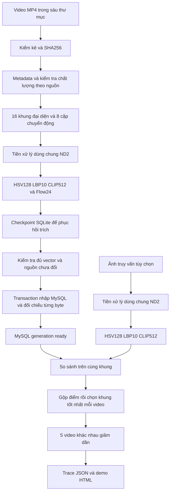

# Phân tích báo cáo và thiết kế bộ khung nhóm 12

**Thiết kế theo môn học:** [THIET_KE_THEO_SLIDE.md](THIET_KE_THEO_SLIDE.md) tổ chức kiến trúc, dữ liệu, metadata, chỉ mục, truy vấn, bằng chứng và đánh giá theo toàn bộ12bài/386trang trong `HeCSDL_DPT_slides`. [Mapping có cấu trúc](course_mapping.json) ghi40nhóm kiến thức, trang PDF, module và phạm vi áp dụng. Dùng cùng mapping yêu cầu/báo cáo bên dưới khi phát triển tiếp.

## Căn cứ và nguyên tắc

Nguồn chính là `D:/video csdldpt/D23-lớp 4 - Nhóm BTL- update.xlsx`, sheet `Trang tính1`, D34:G36; báo cáo `[D23-lớp 04] - Nhóm 12.pdf` và bản Word cùng nhóm. Bản PDF đã thay bìa không còn trong thư mục khi bắt đầu lượt thiết kế này nên sử dụng PDF D23 và nội dung Word đang có. Báo cáo hiện có 37 trang, giới hạn nội dung 1–2.

Thứ tự ràng buộc: đề Excel → đặc tả nhóm đã chốt ở báo cáo ND1–2 → quyết định triển khai mới cho ND3–4. Không lấy video đầu vào, thời lượng tối thiểu 10s, YOLO, Hu moments, DTW hay MySQL của bài D22 làm yêu cầu của nhóm D23.

Cập nhật theo lựa chọn trực tiếp của nhóm: dùng **MySQL** để quản lý/vận hành. Đây là quyết định triển khai của nhóm, không phải điều kiện suy ra từ bài D22. Đã chuyển đủ dữ liệu mới và giữ bốn đặc trưng của ND2, xem [kết quả MySQL](search_phases/03_MYSQL.md).

Không đổi nội dung khoa học chỉ để khớp mã cũ. Ngược lại, các quyết định chưa có trong báo cáo phải được ghi thành quyết định ND3–4. Bộ khung không sử dụng DB 540 video hoặc cache cũ một cách tự động.

## Mapping yêu cầu đến mã và bằng chứng

| Căn cứ | Đặc tả phải giữ | Module / đầu ra |
| --- | --- | --- |
| Excel ND1; báo cáo 1.1–1.3 | ≥500 video, cùng chủ đề thiên nhiên, sáu lớp và ID ổn định | `core.inventory`, snapshot SHA256, `plan.json` |
| 1.2.2–1.2.4 | MP4/H.264, một cảnh, 4–30s theo làm tròn 0,1s; không trùng cảnh | `media.probe`, `pipeline.build`, reviews theo hash nguồn |
| 1.3.3 | Metadata thật, chất lượng cảnh, viền | metadata_json, quality_json, crop_json; không mặc định đủ chất lượng từ tên file |
| 1.4.1, Bảng 1.5 | D1 màu, D2 Canny, D3 bố cục, D4 chủ thể, D5 chênh mức xám; mẫu 120 video | Job khảo sát cần bổ sung; không dùng Optical Flow thay D5 |
| 1.4.3–1.4.5 | So sánh trong/giữa lớp, nhận diện cặp dễ nhầm | Nhãn khảo sát, tập truy vấn và relevance judgments; không dùng class label để lọc truy vấn thật |
| 2.1.3, Bảng 2.8 | K=16, thời điểm .05T+.9T(k+.5)/16, chọn PTS gần nhất | `core.sample_times`, `media.sample`; lưu target và actual time |
| 2.1.3 | Cạnh ngắn 360, max ảnh xám qua16 khung; percentile98<24 OR mean<12; viền≥1%; giữ≥40% | `preprocess.content_box`; cùng xử lý ảnh truy vấn và video |
| 2.3, Bảng 2.4 | HSV toàn ảnh 8×4×4, 128 chiều L1, Bhattacharyya | `features.hsv_hist`, `search.distance` |
| 2.4, Bảng 2.5 | LBP P8 R1 uniform riu2, 10 chiều L1, bỏ biên1px, ảnh xám short256 | `features.lbp_hist`; không tự đổi thành 59/256 chiều |
| 2.5, Bảng 2.6 | CLIP ViT-B/32 sau projection512, letterbox224, L2; không huấn luyện | `features.FrameExtractor`; model identity lưu trong build |
| 2.6, Bảng 2.7 | 8 cặp dt.25, short180, Farnebäck; tổng/cục bộ/hướng8 ô; L1 từng phần | `features.motion_feature`; 24 chiều, ba phần tổng1 |
| 2.2; 2.7.1 | 16×(128+10+512)+24=10.424 số/video; ảnh có650 số | schema, `validate_vector`, `validate_complete` |
| Excel ND3 | Trích đủ toàn bộ đặc trưng cho mọi video, quản trị bằng CSDL | `pipeline.build`, `storage_mysql`, `feature_catalog/frame_features/video_features`; trọng số0 không cho phép bỏ trích LBP |
| Excel ND3, câu "trình bày cơ chế tìm kiếm các video tương đồng"; ND2 §2.6/Bảng2.7 | So video với video bằng CLIP/HSV/LBP/Flow; nhãn ND1 chỉ phục vụ đánh giá | `video_search.py`, `video_workflow/`; [quy trình tự chạy B0–B8](../scripts/video_similarity/README.md), snapshot MySQL, ma trận, bảng lưới, ablation và trace |
| Excel ND4 | Ảnh tùy chọn → đúng5 video khác nhau giảm dần | `pipeline.query_image`, `search.rank`; không tạo motion giả cho ảnh |
| Excel ND4a | Module và dữ liệu vào/ra, quy trình | Sơ đồ dưới, `ports.py`, hợp đồng JSON |
| Excel ND4b | Kết quả trung gian | trace.json: ảnh trước/sau, vector, khoảng cách, điểm, đóng góp, khung và PTS |
| Excel ND4c | Đánh giá | `evaluation.evaluate`; relevance, precision@5, recall@5, AP@5; splits theo ID |
| Excel ND5 | Demo | `demo.html`, CLI; cần xác minh trên môi trường thật |

## Những điểm cần giải quyết trước khi viết ND3–4

1. **Các thống kê cũ không còn mô tả đúng dataset hiện tại.** Đã phát hiện 561 tệp nguồn so với 540 video trong CSDL; 50 kích thước tệp lệch manifest cũ. Bản skeleton dùng hash nguồn, spec, model và generation; sửa video hoặc đổi spec bắt buộc build mới.
2. **Optical Flow:** báo cáo ghi L1 từng phần; mã cũ chia thêm3. Bộ khung giữ từng phần tổng1, toàn vector tổng3. Độ đo Chi-square vì thế có thể tới3 với motion; không áp thang [0,1] của histogram LBP vào motion. Khi triển khai video–video phải chuẩn hóa/hiệu chuẩn riêng và ghi rõ.
3. **Gộp điểm khung → video chưa được báo cáo chốt.** Chọn `best_joint_frame`: tính đủ ba khoảng cách trên cùng một khung, kết hợp rồi lấy khung cao điểm nhất trong video. Tránh lấy màu ở khung A, CLIP ở khung B nhưng chỉ trình diễn B. Đây là đề xuất ND4, cần ghi trong báo cáo mới và thí nghiệm đối chiếu.
4. **Hiệu chuẩn chưa được chốt.** Skeleton dùng thang cố định: s_HSV=1-d_B; s_LBP=1-d_chi; s_CLIP=1-d_cos/2. Không lấy CDF cũ của540 video. Nếu thêm CDF sau này, phải lưu tập calibration, version và split, không dùng test để hiệu chỉnh.
5. **Trọng số không phải kết luận đã chứng minh.** Mặc định thử CLIP.9 HSV.1 LBP0. CLIP chủ đạo phù hợp kết luận ND2; LBP vẫn trích đủ. Cần thử CLIP-only và các tổ hợp trên validation, chốt trước khi đánh giá test.
6. **Không được suy ra ngữ nghĩa chính xác từ điểm.** Không lọc kết quả theo nhãn lớp hoặc tự từ chối ảnh ngoài sáu lớp: đề nhận ảnh tùy chọn và vẫn trả top5. Điểm là tương đối, không phải xác suất.
7. **Tính bất biến trong báo cáo đang viết mạnh.** LBP/HSV nhạy tỷ lệ, nén, ánh sáng trong những tình huống nhất định; trừ median flow chỉ xấp xỉ bù dịch chuyển, không xử lý hoàn toàn zoom/xoay. Viết theo giới hạn thực nghiệm.
8. **Nguồn/bằng chứng khảo sát còn thiếu.** Cần URL video, giấy phép, danh sách120 video, nhãn quan sát và nhật ký kiểm tra scdet/dHash nếu tiếp tục nêu đã sử dụng. Review trong skeleton là dữ liệu đầu vào thật, không phải sự xác nhận tự sinh.
9. **Môi trường:** kết luận ban đầu Python cũ bị lỗi đã được kiểm tra lại: Python chạy được khi có quyền truy cập phù hợp. Dự án có venv riêng, CUDA/CLIP/FFmpeg thật và phiên bản được khóa; không sửa hoặc gỡ môi trường cũ.
10. **Bìa:** MSV Trần Lê Anh Vũ trong Word/PDF là B22DCCN948, Excel ghi B23DCCN948. Phải xác minh trước nộp.

## Kiến trúc và luồng dữ liệu

| Module | Đầu vào | Đầu ra / lỗi phải lộ ra |
| --- | --- | --- |
| Inventory | root và sáu thư mục | ID, đường dẫn tương đối, SHA, size; thiếu thư mục hoặc sai tên là lỗi |
| Media | đường dẫn và target timestamps | metadata và cặp actual PTS/image; không dùng FPS giả nếu không có PTS |
| Preprocess | ảnh RGB / tập16 ảnh | crop chung và ảnh short256; ảnh query chỉ một khung |
| Features | ảnh đã chuẩn hóa / cặp motion | float32 đúng chiều, chuẩn hóa; không thay CLIP bằng vector giả |
| Repository | record và vector | transaction mỗi video; thiếu một feature là lỗi |
| MySQL | bản trích đã chứng nhận, metadata, vector | transaction xuất bản generation; đủ dữ liệu và đối chiếu chính xác mới ready; đọc vector cho truy vấn |
| Search | ảnh vector + index cùng phiên bản |5 hit, cùng khung làm bằng chứng, tie-break ổn định theo ID |
| Evidence | hit + policy + query features | trace có thể tái tính điểm; HTML cục bộ phát video |
| Evaluation | query ID, top5, relevance, split | các chỉ số rõ mẫu số; không gán test=validation |

## CSDL và quản lý phiên bản

`build` giữ spec_hash, model_identity, trạng thái và snapshot danh sách nguồn. `videos` giữ metadata, SHA, crop và review; `keyframes` giữ video_id+frame_index, target_time và actual_time. `frame_features` khóa ngoại theo đúng khung, có HSV/LBP/CLIP; `video_features` chứa motion. `feature_catalog` khai báo chiều, chuẩn hóa, độ đo.

`build` thuộc checkpoint SQLite được giữ để phục hồi và đối chiếu. Trong MySQL, `generations.context_json` giữ toàn bộ bản ghi build cùng môi trường/source audit; các bảng dữ liệu có thêm `generation_id` trong khóa chính và khóa ngoại. Generation chưa ready không được truy vấn. Xem [lược đồ và quản lý MySQL](MYSQL.md).

Khóa chính là ID và index, không dựa vào thứ tự file hoặc reshape ngầm. Thất bại giữa chừng không được gọi là index ready; không bù feature thiếu bằng vector0. Giai đoạn4 đã tối ưu bằng `SearchSession`: xác minh SHA khi khởi tạo, giữ snapshot nguồn/model bằng Windows read-only sharing lease và theo dõi revision MySQL trước/sau truy vấn. Nền tảng không có lease dùng SHA mỗi lượt. Phiên bị invalidation khi file/index/runtime đổi; xem [thiết kế theo slide](THIET_KE_THEO_SLIDE.md).

## Kiểm chứng và điều kiện nghiệm thu

- Dữ liệu đủ≥500; với snapshot hiện tại mong đợi561 video,8.976 keyframe,26.928 vector khung,561 motion.
- Mọi khung có đủ ba feature; vector finite; HSV/LBP tổng1, CLIP norm1, mỗi khối motion tổng1.
- Cả ảnh ngoài bộ dữ liệu, ảnh dọc, ảnh tối và ảnh gần cặp lớp khó vẫn chạy được; lỗi ảnh hỏng phải báo rõ.
- Trả đúng5 ID khác nhau; điểm giảm dần; khung hiển thị chính là khung dùng tính điểm tổng.
- Sửa nội dung video dù giữ nguyên số byte vẫn bị phát hiện; đổi model/spec không dùng lại index.
- Bộ đánh giá có query IDs rõ ràng, ảnh ngoài dữ liệu, nhãn relevant được xét độc lập; phân biệt tìm lại video nguồn và tìm video cùng chủ đề.
- Đánh giá precision@5, recall@5, AP@5; tổng hợp macro và theo nhóm khó, ghi cỡ mẫu/độ trễ/phần cứng. Chưa có job tổng hợp/đo độ trễ hoàn chỉnh trong skeleton.
- Các kiểm thử lõi dùng dữ liệu tổng hợp chỉ kiểm chứng hợp đồng thuật toán, không phải kết quả học thuật hoặc bằng chứng demo CLIP.

## Lộ trình triển khai còn lại

1. Môi trường/model, full extraction và chuyển MySQL đã qua kiểm chứng; giữ kết quả hợp lệ và tiếp tục giai đoạn4 theo `prompts/TIEN_DO.md`.
2. Hoàn tất review nội dung nguồn theo SHA; đã có test adapter VFR/rotation và viền tối, không tự đánh dấu đã review561video.
3. Thêm job khảo sát ND1 và kiểm tra7 cặp C1–C7 bằng ID trong Bảng2.2.
4. Tạo validation/test manifest và relevance judgments; chọn trọng số/gộp khung theo kết quả thực.
5. Bổ sung đồ thị histogram HSV/LBP và thời gian truy vấn vào demo nếu cần trình bày trực quan hơn JSON.
6. Cơ chế video→video ND3 nằm trong module riêng và quy trình B0–B8; xem hướng dẫn đã liên kết. Dùng kết quả thực của từng lần chạy để viết ND3; ảnh→video ND4 có chính sách và đánh giá riêng.
7. Viết ND3: lược đồ, trích feature, kiểm soát phiên bản; ND4: sơ đồ, thuật toán, trace và đánh giá; ND5: demo từng thành viên.
